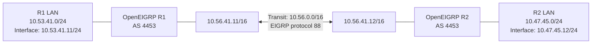

# OpenEIGRP + FRR Alpine image

`ghcr.io/diivious/eigrp-frr` contains Alpine Linux, an FRR source build,
OpenEIGRP (`eigrpd`), Zebra, mgmtd, staticd, watchfrr, and vtysh. Builds are
native Linux `amd64` and `arm64` and share one multi-platform GHCR release tag.

## Pull, start and configure

Use a published **major-minor-edit-beta** release tag, for example
`0-1-0-beta` (the example is not a claim that the image is already published):

```sh
docker pull ghcr.io/diivious/eigrp-frr:0-1-0-beta
docker volume create openeigrp-vol
docker run -d --name openeigrp \
  --cap-add NET_ADMIN --cap-add NET_RAW --cap-add SYS_ADMIN \
  -v openeigrp-vol:/etc/frr \
  ghcr.io/diivious/eigrp-frr:0-1-0-beta

docker exec -it openeigrp vtysh
```

Within vtysh:

```text
configure terminal
router eigrp savage
 address-family ipv4 unicast autonomous-system 4453
  eigrp router-id 10.44.53.1
  network 10.44.0.0 0.0.255.255
 exit-address-family
exit
write memory
show running-config
show eigrp tech-support
```

`write memory` stores the unified FRR configuration in `/etc/frr/frr.conf`
on the Docker volume. Keep the `daemons` file in that volume, with
`eigrpd=yes`, when customizing configuration. FRR starts Zebra, mgmtd and
staticd as supporting services; `watchfrr` supervises all enabled daemons.
`show eigrp tech-support` reports the `EIGRP_RELEASE` build version.
`show eigrp plugin` can use the same portable release API when that CLI is
implemented; it is not part of this Docker delivery.

For a container attached directly to a **Linux** host's LAN, use
`--network host` instead of the Docker bridge, and grant `NET_ADMIN`,
`NET_RAW`, and `SYS_ADMIN`. IP protocol **88** and multicast `224.0.0.10` must be allowed by
host networking and firewalls. The current FRR zebra/mgmtd build additionally
requires `SYS_ADMIN` for its Linux capability setup; these Docker commands grant
that capability rather than using `--privileged`. Treat `SYS_ADMIN` as a broad
privilege and run only trusted images on an appropriately isolated host.
Docker bridge networking also permits
container-to-container experiments but does not by itself expose EIGRP to a
physical LAN. Docker Desktop on macOS does not provide direct raw protocol 88
LAN adjacency through its default networking; this is not a macOS VM guide.

No container SSH server or default password is installed. For administrative
shell access use `docker exec -it -u root openeigrp sh` (or `bash`); Docker
access is the authorization boundary and root needs no `sudo` password.

## Troubleshooting

```sh
docker logs -f openeigrp
docker exec openeigrp pidof watchfrr zebra mgmtd staticd eigrpd
docker exec openeigrp vtysh -c 'show version'
docker exec openeigrp vtysh -d eigrpd -c 'show eigrp tech-support'
docker exec openeigrp cat /etc/frr/daemons
docker restart openeigrp
```

If mounting your own directory at `/etc/frr`, supply **both** `daemons` and
`frr.conf`, readable by the FRR daemon user. A fresh named volume copies the
image's defaults. Container process failures should surface through the
foreground `watchfrr` supervisor.

## Local development, release builds and deployment

Requirements: Docker Engine / Docker Desktop with Buildx, Git, and `rsync`.
The **same** Dockerfile and FRR patch → install → configure → build pipeline
are used for both source modes.

### Local source (no GitHub source checkout)

From your local `eigrp/` checkout, with a sibling `../frr` checkout:

```sh
./tools/docker.sh --local                     # defaults to $USER; platform auto-detected
./tools/docker.sh --test "openeigrp:${USER:-$(id -un)}"
./tools/docker.sh --deploy "openeigrp:${USER:-$(id -un)}"

docker exec -it openeigrp vtysh
```

To specify paths and platform explicitly:

```sh
./tools/docker.sh --local --eigrp-root "$HOME/projects/eigrp" \
  --frr-root "$HOME/projects/frr" --platform linux/arm64 --jobs 8
```

`--local` includes tracked modifications and new, nonignored files in both
source trees; it does **not** re-download either repository from GitHub.
It labels the resulting image using each checkout's HEAD SHA, but such a
SHA does **not** capture uncommitted changes. Local builds with a release
version (for example `0-1-0-beta`) require matching local EIGRP and FRR Git
tags at HEAD and clean working trees.

`--test` is an **integration test**, not the portable/Unix UUT suite: it
starts a throwaway container with its own temporary configuration volume,
verifies required daemons and `vtysh`, configures EIGRP AS 4453, checks
release reporting, saves configuration, restarts, and checks persistence.
It deletes that test container and volume afterward. It requires the image
to be available locally, rather than pulling a missing GHCR release.

`--verify` runs the `--test` integration suite followed by an automated
FRR inspection and **bidirectional EIGRP adjacency plus three-network route
exchange** between two throwaway Docker routers on three isolated bridges.
It verifies the shared /16 and both advertised /24 prefixes, then removes both
containers, both temporary configuration volumes, and all three networks on
success, failure, or interruption. It does **not** alter your image, existing deployments, or
`openeigrp-vol`; an unsuccessful adjacency check returns a nonzero exit status.
For local images you may omit the image argument (defaults to `openeigrp:$USER`):

```sh
./tools/docker.sh --verify
# or specify an image explicitly:
./tools/docker.sh --verify ghcr.io/diivious/eigrp-frr:0-1-0-beta
```

`--verify` includes `--test` itself; running both separately is allowed but
repeats the integration checks. The optional verification is intended for
pre-publication manual acceptance; GitHub Actions continues to run `--test`
until explicitly updated. It does not qualify route convergence or Cisco
interoperability.

`--deploy` starts a **persistent** container named `openeigrp`, verifies
that its required daemons and vtysh are ready, and uses the
`openeigrp-vol` named Docker volume. It uses an image from the local cache
when available and pulls it only if missing. It does **not** run or delete
the test environment. Optional arguments are `--name`, `--volume`, and
`--network bridge|host`. The same named container cannot be deployed twice;
use `docker start openeigrp` or `docker restart openeigrp` thereafter.
If changing Docker capabilities for an existing container, recreate it with
`docker rm -f openeigrp` followed by `--deploy`; restarting an existing
container does not update its capabilities. The named configuration volume is
not removed by `docker rm`.

### Build from GitHub (not from the local working tree)

```sh
./tools/docker.sh --build 0-1-0-beta --platform linux/arm64
./tools/docker.sh --test ghcr.io/diivious/eigrp-frr:0-1-0-beta
./tools/docker.sh --deploy ghcr.io/diivious/eigrp-frr:0-1-0-beta
```

Both `0-1-0-beta` release tags **must already exist** on GitHub:
`diivious/eigrp` and `diivious/frr`. The wrapper fetches and verifies the
exact source commits before passing the sources to Docker Buildx. For CI
nonrelease versions, an explicit `--eigrp-ref` is required and FRR defaults
to a known, compatible commit. Neither local nor remote build automatically
pushes an image to GHCR.

The build always runs these established steps on the selected sources:

```text
tools/frr.sh --patch
tools/frr.sh --install
tools/frr.sh --configure
tools/frr.sh --build
make DESTDIR=... install
```

Any managed FRR patch drift fails the build rather than silently applying
fuzz or invoking a separate integration route.

### Alpine image caching

The Dockerfile uses **`alpine:3.22`** for both build and runtime stages,
with Docker's platform-specific ARM64 or AMD64 manifest selected by Buildx.
Pre-download the base image, if desired:

```sh
docker pull --platform linux/arm64 alpine:3.22
# On an AMD64 host, or if preparing that architecture:
docker pull --platform linux/amd64 alpine:3.22
```

Ordinary builds **do not use `--pull`**. Rebuilds reuse the BuildKit base-image
and compilation cache when available. To explicitly check for a newer base
image, append `--pull-base` to `--local` or `--build`.

Docker Desktop's Buildx builder may have its own cache separate from the
`docker pull` image store; a pre-pull is **not** a guarantee of offline
compilation. Alpine build packages fetched by `apk` and the source checkout
are independent of the Alpine base image and still need to be available or
cached. Alpine `3.22` pins the minor release, **not** an immutable image digest;
an exact historical rebuild also requires preserving the resolved Alpine
image digest and the APK package revisions.

Both Git source SHA labels and the selected release label can be inspected:

```sh
docker image inspect "openeigrp:${USER:-$(id -un)}" \
  --format '{{json .Config.Labels}}'
```

## GitHub Actions release publishing

`.github/workflows/docker.yml` builds amd64 on an x86 runner and arm64 on an
ARM runner. Pushes and pull requests affecting the implementation exercise
both builds. A manual run can test either current development source or an
optional matching release tag **without publishing**. Both jobs execute `tools/docker.sh --verify`, covering daemon startup,
vtysh, named IPv4 AS 4453, configuration save/readback, restart, two-router
adjacency and three-network topology exchange. A tag push publishes only
after **both** jobs pass. It publishes per-architecture images and combines
them into the multi-platform tag:

```text
ghcr.io/diivious/eigrp-frr:0-1-0-beta
ghcr.io/diivious/eigrp-frr:0-1-0-beta-amd64
ghcr.io/diivious/eigrp-frr:0-1-0-beta-arm64
```

Before your first release:

1. Review the changes and commit them on `diivious/eigrp:master`.
2. On **both** GitHub repositories, create/push the **same** approved release
   tag, pointing at the reviewed, compatible source commits. The EIGRP tag
   push is the release trigger; its FRR tag must already be available.
3. In the EIGRP repo, enable GitHub Actions and allow workflows to use
   `GITHUB_TOKEN` for GHCR. The release publish job requests
   `packages: write`; no PAT or stored secret is required. Ensure organization
   policies and GHCR package permissions allow the repo to publish. Configure
   desired package visibility (for public pulls, make the package public).
4. Restrict who can create/move/delete release tags using GitHub rulesets;
   tags should not change after publication.
5. Inspect the Actions run for **both** platform integration tests and the manifest
   publication before advertising the tag.

GitHub read/write actions are separate: this delivery does **not** create tags,
change repository settings, push commits, or publish packages on your behalf.

**Validation boundary:** Building this image and starting actual FRR daemons
requires Docker; repository-only syntax/patch tests do not substitute for the
GitHub Actions integration tests. Physical EIGRP adjacency with Cisco and network
convergence/interoperability are intentionally not release gates here.

## The Docker image has built successfully!

Next verify that FRR starts, OpenEIGRP runs, configuration works, and the
routing daemon can actually communicate with another EIGRP router.

To run **all the checks below automatically**, without leaving a persistent
container or modifying the image you intend to publish, use:

```sh
./tools/docker.sh --verify "openeigrp:${USER:-$(id -un)}"
```

The verifier executes Section 1 first, performs the equivalent of Section 2
in disposable containers, and automates the two-router adjacency and route
exchange checks in Section 3. The following commands remain available for
manual inspection and troubleshooting. `--verify` reports failure unless
**both neighbors remain established and each topology contains exactly three
networks**, including a remote /24 learned via the other router. It always
removes its temporary resources.

### 1. Run the automated Docker integration test

Start with the existing integration test, using the image you just built:

```sh
./tools/docker.sh --test "openeigrp:${USER:-$(id -un)}"
```

The test performs these checks:

| Test | What it verifies |
| --- | --- |
| Container startup | Container starts and remains running |
| FRR processes | watchfrr, mgmtd, zebra, staticd, eigrpd |
| vtysh | Can communicate with FRR and OpenEIGRP |
| Version | `show eigrp tech-support` reports the image's build version |
| Configuration | Named EIGRP instance, IPv4 AS 4453 |
| Retention | Configuration appears in `show running-config` |
| Save | `write memory` saves configuration |
| Restart | Container restarts and reloads saved configuration |
| Stability | Required processes remain running after restart |

A successful test reports a message similar to:

```text
PASS: openeigrp:diivious — FRR, OpenEIGRP, AS 4453, version diivious, save and restart
```

The integration test uses a temporary container and Docker volume, removing
both afterward. It **does not** yet check EIGRP neighbor formation or run the
portable/Unix UUT suite.

### 2. Deploy and inspect OpenEIGRP manually

After the integration test passes, deploy the image for interactive use:

```sh
./tools/docker.sh --deploy "openeigrp:${USER:-$(id -un)}"
```

Verify that the container is running and the required FRR processes exist:

```sh
docker ps
docker exec openeigrp pidof watchfrr zebra mgmtd staticd eigrpd
```

Open the FRR CLI:

```sh
docker exec -it openeigrp vtysh
```

Within vtysh, inspect the installation and configuration:

```text
show version
show daemons
show eigrp tech-support
show running-config
```

You can inspect the startup and runtime logs from the host:

```sh
docker logs --tail 100 openeigrp
```

Unlike the automated test, the deployed container uses a persistent
configuration volume and is **not** automatically removed.

### 3. Verify actual EIGRP communication and three-network routing

The preceding checks prove that the image starts, runs FRR/OpenEIGRP, and
retains configuration. They do **not** prove that EIGRP packets can be
exchanged or that routes are advertised and learned. This lab uses three
Docker bridges to provide **two different prefix lengths**, a shared /16
transit interface on each router, and a separate /24 LAN interface on each:



There are **three destination networks**, not four: `10.53.41.0/24`,
`10.56.0.0/16`, and `10.47.45.0/24`. The routers must become neighbors only
across `10.56.0.0/16`. R1 must learn R2's `/24`, and R2 must learn R1's `/24`.
The two LAN bridges do not connect to one another.

#### Create the lab networks and containers

```sh
docker network create --driver bridge --subnet 10.56.0.0/16 eigrp-test-transit
docker network create --driver bridge --subnet 10.53.41.0/24 eigrp-test-r1-lan
docker network create --driver bridge --subnet 10.47.45.0/24 eigrp-test-r2-lan

docker run -d --name eigrp-r1 \
  --network eigrp-test-transit --ip 10.56.41.11 \
  --cap-add NET_ADMIN --cap-add NET_RAW --cap-add SYS_ADMIN \
  "openeigrp:${USER:-$(id -un)}"

docker run -d --name eigrp-r2 \
  --network eigrp-test-transit --ip 10.56.41.12 \
  --cap-add NET_ADMIN --cap-add NET_RAW --cap-add SYS_ADMIN \
  "openeigrp:${USER:-$(id -un)}"

docker network connect --ip 10.53.41.11 eigrp-test-r1-lan eigrp-r1
docker network connect --ip 10.47.45.12 eigrp-test-r2-lan eigrp-r2
```

Confirm that each router actually has **two Linux interfaces**, with the
correct address masks:

```sh
docker exec eigrp-r1 ip -o -4 addr show
docker exec eigrp-r2 ip -o -4 addr show
```

#### Configure both routers for AS 4453

```sh
docker exec eigrp-r1 vtysh -d eigrpd \
  -c 'configure terminal' \
  -c 'router eigrp savage' \
  -c 'address-family ipv4 unicast autonomous-system 4453' \
  -c 'eigrp router-id 10.56.41.11' \
  -c 'network 10.56.0.0 0.0.255.255' \
  -c 'network 10.53.41.0 0.0.0.255' \
  -c 'end'

docker exec eigrp-r2 vtysh -d eigrpd \
  -c 'configure terminal' \
  -c 'router eigrp savage' \
  -c 'address-family ipv4 unicast autonomous-system 4453' \
  -c 'eigrp router-id 10.56.41.12' \
  -c 'network 10.56.0.0 0.0.255.255' \
  -c 'network 10.47.45.0 0.0.0.255' \
  -c 'end'
```

The `network` commands use wildcard masks, while the resulting topology
prefixes use standard `/16` and `/24` masks.

#### Verify neighbor adjacency and route exchange

```sh
docker exec eigrp-r1 vtysh -d eigrpd \
  -c 'show eigrp address-family ipv4 4453 neighbors'
docker exec eigrp-r2 vtysh -d eigrpd \
  -c 'show eigrp address-family ipv4 4453 neighbors'

docker exec eigrp-r1 vtysh -d eigrpd \
  -c 'show eigrp address-family ipv4 topology 4453'
docker exec eigrp-r2 vtysh -d eigrpd \
  -c 'show eigrp address-family ipv4 topology 4453'
```

**Expected result:** R1 has neighbor `10.56.41.12`, and R2 has neighbor
`10.56.41.11`. Each topology contains these exact three prefixes:

| Prefix | R1 | R2 |
| --- | --- | --- |
| `10.56.0.0/16` | Connected transit | Connected transit |
| `10.53.41.0/24` | Connected LAN | Learned via `10.56.41.11` |
| `10.47.45.0/24` | Learned via `10.56.41.12` | Connected LAN |

To inspect each **remote** route and its next hop directly:

```sh
docker exec eigrp-r1 vtysh -d eigrpd \
  -c 'show eigrp address-family ipv4 topology 4453 10.47.45.0/24'
docker exec eigrp-r2 vtysh -d eigrpd \
  -c 'show eigrp address-family ipv4 topology 4453 10.53.41.0/24'
```

If verification fails before adjacency, the tool also prints each router's
IGMP memberships and captures Ethernet frames carrying IP protocol 88 on
its transit interface for 12 seconds. Compare inbound and outbound frames
on R1/R2 to distinguish Docker multicast forwarding problems from EIGRP
receive-path problems. Packet capture is passive and runs only in the
verification containers; it does not modify the image or host bridge.

`tools/docker.sh --verify` performs these checks automatically, requiring
both remote prefixes to be learned through the peer, as well as exactly
three topology destinations on each router. It checks again after an interval
to reject transient success. This verifies basic route advertisement and
learning, but not complete convergence qualification or Cisco interoperability.

If neighbor formation or learning fails, inspect interfaces, packet counters,
and logs:

```sh
docker exec eigrp-r1 vtysh -d eigrpd \
  -c 'show eigrp address-family ipv4 4453 interfaces'
docker exec eigrp-r1 vtysh -d eigrpd \
  -c 'show eigrp address-family ipv4 4453 traffic'
docker logs --tail 100 eigrp-r1
docker logs --tail 100 eigrp-r2
```

When finished, remove **only these manual lab resources**, including Docker's
anonymous configuration volumes. Your regular `openeigrp` deployment and
`openeigrp-vol` remain untouched:

```sh
docker rm -fv eigrp-r1 eigrp-r2
docker network rm eigrp-test-r1-lan eigrp-test-r2-lan eigrp-test-transit
```

The two-router test is automated by `tools/docker.sh --verify`. GitHub Actions
also runs `--verify` on both native architectures before publishing any
GHCR release image.
