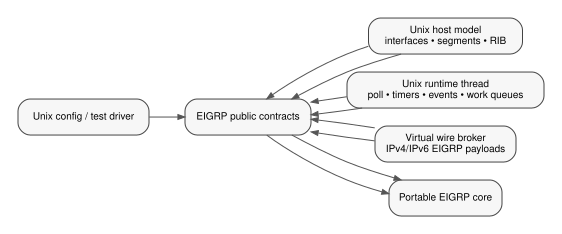

# OpenEIGRP Unix Host Integration Specification

Copyright (C) 2026 Donnie V. Savage

## 1. Scope

This document defines the concrete integration contract between the portable
OpenEIGRP core and the standalone Unix host adapter under `unix/`.

The Unix adapter is the native macOS/Linux host used for portable development,
UUT execution, and host-independent integration testing. It is not an FRR
compatibility layer, it is not a BIRD compatibility layer, and it is not another
EIGRP implementation.

This specification answers a different question than `specs/public-api.md`:

- `specs/public-api.md` defines the complete host-neutral core/shim API;
- this document defines how the Unix shim implements and consumes that API;
- `unix/README.md` is an operator/developer orientation page, not the detailed
  integration contract.

The public API remains authoritative in the installed portable headers:

```text
eigrp/code/eigrp.h
eigrp/code/eigrp_cli.h
eigrp/code/eigrp_mgnt.h
eigrp/code/eigrp_rib.h
eigrp/code/eigrp_sys.h
```

Unix-private declarations under `unix/code/` must not leak into portable
OpenEIGRP headers or APIs.

## 2. Naming

OpenEIGRP is the implementation project. EIGRP is the routing protocol.

The Unix implementation therefore retains existing `eigrp_*` C symbols,
`EIGRP_*` constants, EIGRP packet terminology, and `router eigrp` configuration
syntax where applicable. The project rebrand does not rename protocol-visible
or source-level EIGRP identifiers.

## 3. Unix adapter responsibilities

The Unix adapter owns host mechanics only:

- process/runtime scheduling;
- timers and immediate events;
- read/write readiness;
- work queues;
- monotonic and wall-clock time;
- default-VRF resolution;
- host-side interface inventory;
- connected/source-route modeling;
- host RIB storage for routes selected by OpenEIGRP;
- redistribution subscription and source-route notification;
- logical shared-segment membership;
- local virtual packet transport through `eigrp-wire`;
- standalone configuration parsing;
- serialization between host-side mutations and portable callbacks;
- host-side observation helpers used by Unix tests/UUT front ends.

It does not own:

- DUAL;
- topology-table semantics;
- successor/feasible-successor selection;
- EIGRP metric calculation;
- neighbor state-machine decisions;
- RTP sequencing, acknowledgment, retransmission, or packetization;
- EIGRP TLV parsing/encoding;
- EIGRP message semantics;
- protocol policy decisions that belong in portable OpenEIGRP.

## 4. Source ownership map

```text
unix/code/eigrp_unix_sys.c
    pthread/poll runtime, timers, events, fd readiness, work queues,
    time services, default-VRF resolution

unix/code/eigrp_unix_interface.c
    Unix host interface/address inventory and notifications into the core

unix/code/eigrp_unix_rib.c
    in-memory host RIB, installed EIGRP routes, redistributed source routes

unix/code/eigrp_unix_segment.c
    logical shared-medium membership used by the virtual wire

unix/code/eigrp_unix_wire.c
    core packet-I/O implementation over the local broker connection

unix/code/eigrp_unix_wire_broker.c
    out-of-process Unix-domain packet forwarding broker

unix/code/eigrp_unix_config.c
    standalone text configuration parser -> semantic public API calls

unix/code/eigrp_unix.h
    Unix-private runtime/fd serialization helpers

unix/code/eigrp_unix_interface.h
unix/code/eigrp_unix_rib.h
unix/code/eigrp_unix_segment.h
unix/code/eigrp_unix_config.h
unix/code/eigrp_unix_wire.h
    Unix-private host-model and test/UUT interfaces
```

None of the `eigrp_unix_*` types are portable public OpenEIGRP API types.

## 5. Boundary model




The Unix shim sits between host mechanics and the portable public API.

```text
+--------------------------+
| Unix host / UUT frontend |
| config, tests, topology  |
+------------+-------------+
             |
             v
+--------------------------+
| unix/code/               |
|                          |
| config     interface     |
| RIB        runtime       |
| segment    virtual wire  |
+-----+---------------+----+
      |               ^
      | public API    | public API
      v               |
+--------------------------+
| portable OpenEIGRP core  |
| eigrp/code/              |
+--------------------------+
```

Every crossing must use EIGRP-owned public types from the five public headers.
POSIX descriptors, pthread objects, Unix-domain socket structures, Unix-private
interface objects, segment objects, and in-memory RIB nodes remain on the Unix
side.

## 6. Direction table

The important Unix/core crossings are:

| Function family | Direction | Unix implementation/use |
|---|---|---|
| `eigrp_sys_runtime_*` | core/bootstrap -> Unix | start/stop pthread runtime |
| `eigrp_sys_event_*`, `eigrp_sys_timer_*` | core -> Unix | schedule/cancel callbacks |
| `eigrp_sys_read_add`, `eigrp_sys_write_add` | core -> Unix | map instance to private fd and poll readiness |
| `eigrp_sys_work_queue_*` | core -> Unix | Unix-owned queue objects executing core callbacks |
| `eigrp_sys_vrf_resolve` | core/config -> Unix | resolve only default VRF |
| `eigrp_sys_interface_walk` | core -> Unix | enumerate normalized host interface/address state |
| `eigrp_sys_intf_update/down/remove/addr_update` | Unix -> core | notify interface/address lifecycle |
| `eigrp_sys_socket_*` | core -> Unix | broker connection lifecycle |
| `eigrp_sys_multicast_*` | core -> Unix | register active interface/address endpoints |
| `eigrp_sys_*packet_send` | core -> Unix | encode wire envelope and send to broker |
| `eigrp_sys_*packet_receive` | core receive path -> Unix | read broker frame and return normalized metadata |
| `eigrp_rib_route_add/del` | core -> Unix | install/remove learned EIGRP route in memory |
| `eigrp_rib_redistribute_add/remove` | core -> Unix | subscribe/unsubscribe to host source protocol |
| `eigrp_rib_redist_add/del` | Unix -> core | deliver subscribed source-route changes |
| `eigrp_cli.h` semantic targets | Unix config -> core | apply parsed configuration |
| `eigrp_mgnt.h` readers/iterators | Unix frontend -> core | observe protocol state without private traversal |

The complete list of public symbols and data structures is defined in
`specs/public-api.md`. This document only maps those contracts onto the Unix
implementation.

## 7. Runtime and execution context

### 7.1 Runtime thread

`eigrp_sys_runtime_init()` creates:

- a wake pipe;
- a runtime state object protected by `runtime.lock`;
- one pthread running the `poll(2)` event loop.

The runtime thread executes portable callbacks for:

- immediate events;
- timers;
- read readiness;
- write readiness;
- work-queue dispatch.

The runtime event object is Unix-private even though it fulfills the opaque
`eigrp_event_t` identity expected by the public API.

### 7.2 Protocol serialization

Portable callbacks execute on the runtime thread. Unix host-management actions
may originate on another thread.

`eigrp_unix_runtime_enter()` / `eigrp_unix_runtime_leave()` protect portable
protocol state with a Unix-private `protocol_lock`.

The required rule is:

```text
host mutation thread                 runtime callback thread
--------------------                 -----------------------
eigrp_unix_runtime_enter()           select ready event
    mutate host model                eigrp_unix_runtime_enter()
    call portable API                    call portable callback
    return                               return
eigrp_unix_runtime_leave()           eigrp_unix_runtime_leave()
```

The two contexts must never mutate portable core state concurrently.

### 7.3 Event ownership

When the core schedules an event:

```text
portable core
    -> eigrp_sys_event_add()/timer_add()/read_add()/write_add()
        -> Unix allocates struct eigrp_event
        -> records callback, arg, owner, due time/fd
        -> inserts into runtime.events
        -> wakes poll thread
```

When the event fires:

```text
poll thread
    -> remove one ready event
    -> clear caller's owner pointer
    -> acquire protocol_lock
    -> callback(arg)
    -> release protocol_lock
```

Cancellation must clear both the runtime list entry and the caller-visible
opaque owner pointer.

## 8. Startup and shutdown

The standalone Unix UUT uses the following effective startup order:

```text
Unix process
    -> eigrp_sys_runtime_init()
         start Unix scheduler thread
    -> eigrp_init()
         initialize portable process state
         start portable packet receive thread
    -> build Unix interface/address/segment model
    -> create OpenEIGRP AF configuration through eigrp_cli.h
    -> apply router-id/networks/interface semantic configuration
    -> bring Unix interfaces operational
         -> publish connected routes
         -> notify portable interface state
    -> normal protocol operation
```

Interfaces should become operational only after the relevant EIGRP
configuration and metric inputs are present. This prevents adjacency startup
from racing partially applied UUT configuration.

Shutdown is the reverse ownership order:

```text
stop external commands/input
    -> delete OpenEIGRP configuration/runtime contexts
    -> reset segment model
    -> reset interface model
    -> eigrp_rib_finish()
    -> eigrp_sys_runtime_finish()
```

No Unix event callback or fd binding may outlive the portable instance it
references.

## 9. Configuration flow

`eigrp_unix_config.c` is a standalone parser. It is not a second configuration
model and must not implement EIGRP semantics itself.

The flow is:

```text
text configuration
    -> eigrp_unix_config_apply_file()/apply_text()
    -> parse Unix standalone syntax
    -> normalize strings/numbers/addresses
    -> call owning eigrp_cli.h semantic target
    -> return eigrp_result_t + optional error line
```

Examples include:

```text
router eigrp NAME
    -> named parent creation/read through public configuration API

address-family ipv4 autonomous-system AS
    -> eigrp_af_config_create(...)

 eigrp router-id A.B.C.D
    -> eigrp_instance_router_id_update(...)

shutdown / no shutdown
    -> address-family shutdown semantic target
```

The Unix parser must not read or write private portable configuration structs.

## 10. Interface model and notifications

### 10.1 Host inventory

`eigrp_unix_interface.c` owns an in-memory interface inventory containing host
properties such as:

- name;
- ifindex;
- operational state;
- multicast capability;
- bandwidth;
- MTU;
- IPv4/IPv6 addresses;
- secondary-address attribute.

The corresponding `eigrp_unix_interface_t` is Unix-private.

### 10.2 Initial/core-driven discovery

When portable OpenEIGRP wants current host state:

```text
portable instance
    -> eigrp_sys_interface_walk(instance, callback, arg)
    -> Unix walks every interface/address matching instance AF
    -> fills eigrp_intf_runtime_state_t
    -> callback(&state, arg)
    -> portable core creates/updates runtime interface state
```

Only normalized `eigrp_intf_runtime_state_t` crosses the boundary.

### 10.3 Interface up

```text
Unix frontend/test
    -> eigrp_unix_interface_up(name)
    -> protocol_lock
    -> mark Unix interface operative
    -> publish connected source route(s)
         -> eigrp_unix_rib_source_route_update()
    -> for each address:
         fill eigrp_intf_runtime_state_t
         -> eigrp_sys_intf_update(default_vrf, &state)
    -> portable core evaluates configured participation
    -> protocol_lock release
```

### 10.4 Interface down

```text
Unix frontend/test
    -> eigrp_unix_interface_down(name)
    -> protocol_lock
    -> withdraw connected source route(s)
    -> mark Unix interface non-operative
    -> eigrp_sys_intf_down(default_vrf, ifindex, name, ...)
    -> portable core tears down affected runtime state/adjacencies
    -> protocol_lock release
```

### 10.5 Address add

```text
Unix frontend
    -> eigrp_unix_interface_address_add()
    -> add address to Unix inventory
    -> if interface is up:
         construct connected eigrp_rib_route_t
         -> eigrp_unix_rib_source_route_update()
    -> fill eigrp_intf_runtime_state_t
    -> eigrp_sys_intf_update()
```

### 10.6 Address remove

```text
Unix frontend
    -> eigrp_unix_interface_address_remove()
    -> remove address from Unix inventory
    -> withdraw connected source route when no equivalent prefix remains
    -> eigrp_sys_intf_addr_update(..., EIGRP_INTERFACE_REMOVE_HOST)
    -> republish remaining interface addresses through intf_update
```

### 10.7 Interface delete

```text
Unix frontend
    -> eigrp_unix_interface_delete()
    -> detach interface from all logical segments
    -> withdraw connected source routes
    -> eigrp_sys_intf_remove(..., EIGRP_INTERFACE_REMOVE_HOST)
    -> free Unix-private addresses/interface
```

## 11. Host RIB integration

The Unix RIB is intentionally in-memory. It does not install routes into the
macOS or Linux kernel routing table.

It contains two logically separate collections:

```text
learned_routes
    routes selected by portable OpenEIGRP and installed into the Unix host RIB

source_routes
    host-originated routes eligible for redistribution into OpenEIGRP
```

It also tracks redistribution subscriptions per OpenEIGRP instance.

### 11.1 Core -> Unix learned route install

```text
DUAL/topology selects installed route
    -> public RIB contract
    -> eigrp_rib_route_add(instance, route)
    -> Unix validates/copies eigrp_rib_route_t
    -> insert or replace learned_routes entry
    -> Unix walkers/UUT can observe installed route
```

Delete is symmetrical:

```text
portable core
    -> eigrp_rib_route_del(instance, prefix)
    -> locate matching learned_routes entry
    -> free Unix-owned copy
```

The core never receives a pointer to a Unix RIB node.

### 11.2 Redistribution subscription

When EIGRP configuration enables redistribution:

```text
portable core
    -> eigrp_rib_redistribute_add(instance, source)
    -> Unix records subscription
    -> Unix finds matching existing source_routes
    -> eigrp_rib_redist_add(instance, &route) for each match
```

When disabled:

```text
portable core
    -> eigrp_rib_redistribute_remove(instance, source)
    -> Unix removes subscription
    -> source is no longer delivered into that instance
```

### 11.3 Host source-route update

```text
Unix interface/test/front end
    -> eigrp_unix_rib_source_route_update(route)
    -> insert/replace source_routes entry
    -> for each matching AF/protocol subscription:
         eigrp_rib_redist_add(instance, &normalized_route)
    -> portable redistribution logic
    -> topology/DUAL as appropriate
```

### 11.4 Host source-route removal

```text
Unix host model
    -> eigrp_unix_rib_source_route_remove(route)
    -> for matching subscribers:
         eigrp_rib_redist_del(instance, &normalized_route)
    -> remove Unix source_routes entry
    -> if another route for same prefix/source becomes selected,
       notify subscribers of replacement
```

This boundary is the Unix equivalent of a real routing stack's redistribution
feed, but it remains host-independent and in-memory.

## 12. Packet I/O and virtual wire

The Unix adapter does not use raw IP protocol 88 sockets. Protocol packet I/O is
transported over a local Unix-domain `SOCK_STREAM` connection to `eigrp-wire`.

The EIGRP payload itself is not rewritten by the Unix shim.

### 12.1 Socket open

```text
portable instance startup
    -> eigrp_sys_socket_open(instance)
    -> Unix connect(AF_UNIX, EIGRP_UNIX_WIRE_SOCKET/default path)
    -> create instance -> fd binding
    -> eigrp_unix_runtime_fd_set(instance, fd)
```

The descriptor is Unix-private and never crosses the public OpenEIGRP API.

### 12.2 Multicast registration

`eigrp_sys_multicast_join()` registers the active Unix interface/address with
the broker:

```text
portable interface
    -> eigrp_sys_multicast_join(instance, intf)
    -> map opaque portable intf to name
    -> find Unix host interface by name
    -> find logical segment membership
    -> for each address in the instance AF:
         send EIGRP_UNIX_WIRE_REGISTER envelope to broker
```

This registration substitutes for real host multicast-group membership.

### 12.3 Core -> Unix packet send

```text
portable RTP/packetizer
    -> eigrp_sys_ipv4_packet_send() / eigrp_sys_ipv6_packet_send()
       (both delegate to eigrp_sys_packet_send())
    -> locate Unix fd binding for instance
    -> map portable interface -> Unix interface -> logical segment
    -> select source address
    -> construct eigrp_unix_wire_header_t
    -> append segment name + interface name + unchanged EIGRP bytes
    -> send complete frame to eigrp-wire broker
```

The broker determines multicast fanout or unicast destination based on the
registration metadata. The portable core remains unaware of broker mechanics.

### 12.4 Broker forwarding

```text
sender UUT Unix shim
    -> Unix-domain stream
    -> eigrp-wire broker
       if multicast:
           fan out to registered endpoints on same logical segment
       if unicast:
           select registered destination interface/address
    -> destination UUT Unix-domain stream
```

The broker is a control-plane delivery mechanism, not an Ethernet simulator.
It intentionally has no:

- MAC learning;
- ARP;
- IPv6 ND;
- VLAN model;
- switch forwarding database;
- data-plane packet forwarding.

### 12.5 Unix -> core packet receive

```text
runtime poll notices broker fd readable
    -> core-scheduled read callback
    -> portable packet receive path
    -> eigrp_sys_ipv4_packet_receive() / eigrp_sys_ipv6_packet_receive()
       (delegate to eigrp_sys_packet_receive())
    -> Unix reads one versioned broker envelope
    -> validates frame/name/payload lengths
    -> copies unchanged EIGRP bytes into caller buffer
    -> returns:
         ifindex
         source eigrp_address_t
         destination eigrp_address_t
         eigrp_packet_rx_meta_t
    -> portable packet validation/demux/RTP/message processing
```

For the virtual wire:

```text
meta.ingress_vrf_id       = instance VRF
meta.network_header_length = 0
meta.eigrp_length          = broker payload length
meta.destination_multicast = envelope multicast flag
```

No POSIX socket structure or wire envelope is visible to portable packet code.

## 13. Logical segment model

`eigrp_unix_segment.c` models only shared control-plane membership.

A segment contains N endpoints identified by:

- UUT name;
- Unix interface name;
- optional bound `eigrp_unix_interface_t`.

An interface may be attached to at most one logical segment at a time.

Segment membership is host/test topology state; it is not portable EIGRP state.
The portable core learns only interface state and received packet metadata.

## 14. Work queues

The Unix implementation of `eigrp_work_queue_t` stores:

- owning portable instance;
- queue name;
- core work callback;
- optional deletion callback;
- Unix-private linked-list items;
- one scheduled event;
- blocked state.

Flow:

```text
portable core
    -> eigrp_sys_work_queue_enqueue(queue, data)
    -> Unix append item
    -> schedule immediate runtime event if needed
    -> runtime thread calls core workfunc(queue, data)
       -> SUCCESS: remove item
       -> REQUEUE: move item to tail
       -> BLOCKED: retain item and stop scheduling until later enqueue/unblock path
```

The queue implementation must not interpret the work item as protocol data.

## 15. VRF behavior

The standalone Unix shim currently supports only the default VRF.

```text
eigrp_sys_vrf_resolve(NULL or "default")
    -> EIGRP_VRF_DEFAULT

any other VRF name
    -> EIGRP_RESULT_UNSUPPORTED
```

Names other than the default VRF return `EIGRP_RESULT_UNSUPPORTED`; the Unix
shim must not fake multi-VRF behavior by mapping distinct names to the default
VRF.

## 16. Policy and authentication host services

The standalone Unix shim owns the policy callbacks in
`unix/code/eigrp_unix_policy.c` and the keychain lookup in
`unix/code/eigrp_unix_keychain.c`. The UUT executable does not define
`eigrp_sys_*` policy or authentication-key callbacks.

The Unix keychain provider is a small in-memory store. No key or test password
is built in: Unix configuration or test orchestration must explicitly register
keys through the Unix-owned `eigrp_unix_keychain_add()` interface. Missing
keys return false from `eigrp_sys_auth_key_lookup()`. A future Unix-native
configuration backend can use the same private provisioning API without
changing the portable authentication contract.

**Unix policy execution is not complete.** The policy adapter preserves the
existing neutral evaluation results for now (ordinary filters and route maps
permit; summary leak maps deny), but does not provide Unix ACL/prefix-list/
route-map databases. Do not treat this as a production policy engine. It must
be completed before using configured policy with standalone Unix routing.

The public EIGRP system boundary remains the host-service contracts in
`eigrp/code/eigrp_sys.h`. Unix-specific configuration objects, keychain
storage, and policy objects must never leak into portable EIGRP code.
